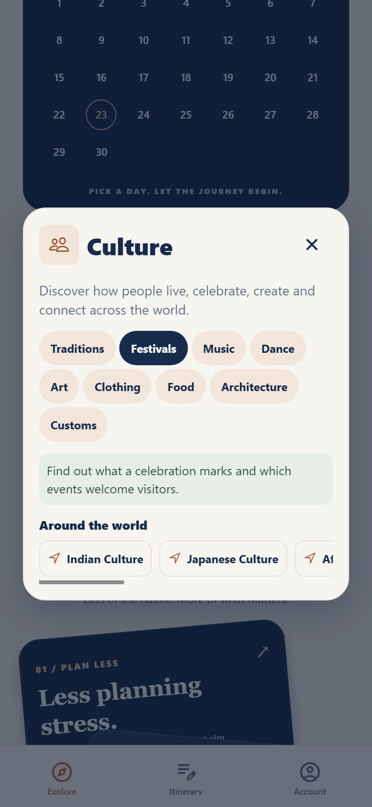
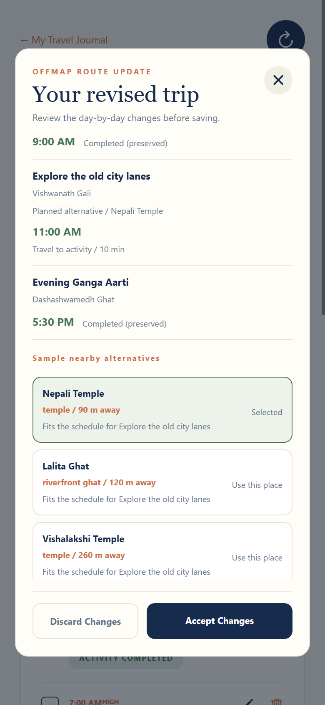
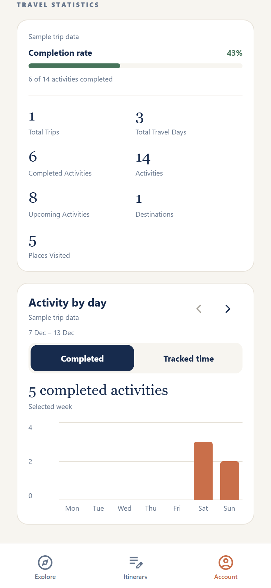
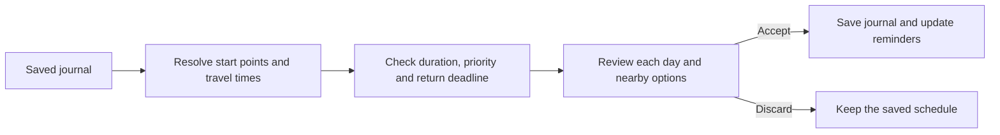

<h1 align="center">OFFMAP</h1>

<p align="center">
  A travel planner and journal that helps you rearrange a trip when plans change.
</p>

<p align="center">
  <strong><a href="https://expo.dev/accounts/amanjeeta/projects/offmap/builds/6f1bca92-a7c4-4307-9d86-70b919ede227">↓ Get the Android APK</a></strong>
  &nbsp;·&nbsp; <a href="#try-the-varanasi-demo">Try the Varanasi demo</a>
  &nbsp;·&nbsp; <a href="#run-locally">Run locally</a>
</p>

<p align="center"><strong>Expo SDK 58</strong> &nbsp;·&nbsp; React Native &nbsp;·&nbsp; TypeScript</p>

|                                                    Explore                                                     |                                                                  Replan                                                                   |                                                                Remember                                                                |
| :------------------------------------------------------------------------------------------------------------: | :---------------------------------------------------------------------------------------------------------------------------------------: | :------------------------------------------------------------------------------------------------------------------------------------: |
|  |  |  |
|                                Open an interest and discover what to look for.                                 |                                       Review a nearby alternative before it changes your itinerary.                                       |                                          See how completed activities become a travel record.                                          |

_Screens captured from the app at a mobile browser viewport using the built-in sample trip._

## What OFFMAP does

Say you stay longer than planned at your first stop. The next visit has to fit around travel time, the activities you want to protect, and when you need to get back. OFFMAP checks the remaining trip, shows what can move, and lets you review the result before you save it.

| Feature                  | What you can do                                                                                                                                                                                                                        |
| ------------------------ | -------------------------------------------------------------------------------------------------------------------------------------------------------------------------------------------------------------------------------------- |
| **Explore**              | Pick a date from the calendar to start planning, or open a discovery card for Culture, Food, Adventure, Nature, History, or Shopping. Each card has interactive tips and scrollable examples.                                          |
| **Plan and track**       | Create a multi-day journal with activities, priorities, durations, notes, accommodation, and daily return deadlines. Start and complete activities to record actual times.                                                             |
| **Replan the trip**      | Check whether flexible activities fit around travel and fixed commitments. Review every day, inspect reasons for unscheduled visits, and choose a nearby alternative when one fits. The original activity name and place stay visible. |
| **Get a reminder**       | On a supported device with notifications enabled, receive a local reminder scheduled five minutes before an upcoming activity. Saving a new schedule updates its pending reminders.                                                    |
| **Keep a travel record** | See weekly activity charts, tracked time, visit counts, and completion insights. Attach photos to completed visits and keep a profile photo in Account.                                                                                |

## Tech stack

| Area              | Technology                  |
| ----------------- | --------------------------- |
| Mobile app        | React Native, Expo SDK 58   |
| Language          | TypeScript                  |
| Navigation        | Expo Router                 |
| Local persistence | AsyncStorage                |
| Location          | Expo Location               |
| Nearby places     | Overpass API                |
| Geocoding         | Nominatim, Photon fallback  |
| Routing           | OSRM                        |
| Notifications     | Expo Notifications          |
| Images            | Expo Image Picker           |
| Backend           | Node.js + Express           |
| Development       | npm, Git, GitHub, EAS Build |

The application follows a **local-first architecture**. Journals, activities, preferences, and memories are persisted locally, while live location and mapping services are used when required.

## Try the Varanasi demo

1. Open the [Android build page](https://expo.dev/accounts/amanjeeta/projects/offmap/builds/6f1bca92-a7c4-4307-9d86-70b919ede227) on your phone, download the APK, and install it. Android may ask you to allow installs from the browser or file manager.
2. Open **Itinerary → Varanasi Diaries → Open notebook**. Tap the refresh icon in the journal header to **Replan my trip**.
3. In **Sample nearby alternatives**, choose **Nepali Temple** or **Lalita Ghat**. The preview shows the choice separately from the original location.
4. Tap **Accept Changes**, then leave and reopen the journal to see the saved choice. To compare, run another preview and tap **Discard Changes**.
5. Open **Account**, change the chart week, and use **Add Memory** to attach a photo to a completed sample visit.

The three-day demo uses bundled places and illustrative travel times, so its replan works without GPS permission or a live map service. Personal journals use live location and mapping data when available.

## How replanning works



The planner preserves completed activities and works around in-progress and fixed commitments. It evaluates gaps for medium- and low-priority visits and can move flexible activities to later days when they fit.

Live replanning uses walking or driving travel estimates, and GPS can anchor today's remaining itinerary. Accepted changes are saved through the journal context using the existing activity IDs.

## Account and travel insights

The Account section turns itinerary activity into a lightweight travel record.

It includes:

- Total trips and travel days
- Total and completed activities
- Completion rate
- Destinations and visited places
- Most visited places
- Longest trip
- Most active day
- Common activity priority
- Weekly activity tracking
- Travel memories
- Profile information
- Quote of the Day
- Theme preferences

Statistics are calculated from the existing journal and activity data rather than being stored as separate hardcoded values.

Sample journal data is available for demonstration so the statistics and activity chart can be viewed immediately.

## Memories

Completed activities can be turned into travel memories by attaching a photo and optional note.

A memory can contain:

- Place
- Visit date
- Trip/journal
- Photo
- Optional note

Memories are stored separately from the original activity, so editing or deleting a memory does not remove the associated itinerary activity.

## Location and nearby places

OFFMAP uses the device's current location when live location is required.

Nearby-place discovery uses the existing map services to find meaningful places around a planned destination. Searches can progressively consider approximately 50 m, 100 m, and 200 m depending on availability.

The planner can use these results as **nearby alternatives** when the original activity becomes impractical because of time constraints.

The original activity name and intended location are preserved; a nearby alternative is treated as additional planning information rather than silently replacing the original activity.

## Notifications

OFFMAP uses local device notifications for upcoming activities.

By default:

```text
Activity: 10:00 AM
Reminder: 9:55 AM
```

The reminder does not automatically complete the activity.

Users can manually start and complete activities, while changing or deleting an activity updates its pending reminder.

Native notification behavior depends on device permissions and Android system restrictions.

## Run locally

Use npm and a Node.js version supported by Expo SDK 58, such as Node.js 24.3 or later in the 24.x line. See the [Expo SDK reference](https://docs.expo.dev/versions/v58.0.0/).

```bash
git clone https://github.com/Amanjeeta21/offmap.git
cd offmap
npm ci
npm run web
```

Use `npm start` to open the Expo development menu for device testing.

If Windows PowerShell blocks npm or npx scripts, use `npm.cmd` and `npx.cmd`.

The [Expo setup guide](https://docs.expo.dev/get-started/set-up-your-environment/) covers device and emulator options.

### Optional configuration

The app ships with public map endpoint defaults and bundled quotes. Copy `.env.example` to `.env` to use the example quotes feed or override a service URL.

| Environment variable            | Purpose                                  |
| ------------------------------- | ---------------------------------------- |
| `EXPO_PUBLIC_NOMINATIM_API_URL` | Forward and reverse geocoding            |
| `EXPO_PUBLIC_PHOTON_API_URL`    | Fallback place search                    |
| `EXPO_PUBLIC_OVERPASS_API_URL`  | Nearby named landmarks and places        |
| `EXPO_PUBLIC_OSRM_FOOT_URL`     | Walking routes and travel-time estimates |
| `EXPO_PUBLIC_OSRM_CAR_URL`      | Driving routes and travel-time estimates |
| `EXPO_PUBLIC_QUOTES_API_URL`    | Optional quote feed                      |

Treat `EXPO_PUBLIC_*` values as public. Expo embeds them in the app bundle.

See the [Expo environment variable guide](https://docs.expo.dev/guides/environment-variables/).

## Permissions

Some OFFMAP features require device permissions:

| Permission             | Used for                                    |
| ---------------------- | ------------------------------------------- |
| Location               | Current position and nearby-place discovery |
| Notifications          | Activity reminders                          |
| Camera / Photo Library | Travel memories and profile photos          |

Permissions are requested only when the corresponding feature requires them.

The core journal and itinerary functionality remains available without location access.

## Checks and Android build

Run the following checks before creating a release build:

```bash
npx tsc --noEmit
npm run lint
npx expo install --check
```

From the project root, build an installable APK with an Expo account that has access to the project.

The `preview` profile creates an Android APK. The `production` profile creates an Android App Bundle for Play Store submission.

```bash
npx eas-cli@latest build --platform android --profile preview
```

See the [Expo APK guide](https://docs.expo.dev/build-reference/apk/) for more information.

For native reminder testing, allow notifications on Android and use **Enable precise reminders** in Account if that option appears. Without exact-alarm access, Android may deliver at an approximate time.

See [Expo Notifications](https://docs.expo.dev/versions/v58.0.0/sdk/notifications/).

## Project layout

| Area                              | What's inside                                                                        |
| --------------------------------- | ------------------------------------------------------------------------------------ |
| `src/app/`                        | Expo Router screens for Explore, Itinerary, Account, and journal creation and detail |
| `src/components/`                 | Discovery popups, Account charts, photo flows, and shared UI                         |
| `src/context/journal-context.tsx` | Journals, sample data, activity tracking, and local persistence                      |
| `src/services/`                   | GPS, geocoding, routing, nearby search, and native reminders                         |
| `src/services/replanning/`        | Multi-day scheduling, route-aware alternatives, and the offline demo                 |
| `backend/`                        | Optional Express server with a health endpoint                                       |

The Expo client runs independently of the Express server.

To try the server:

```bash
cd backend
npm ci
npm run dev
```

Then open `/api/health` on port 5000.

## Data and privacy

OFFMAP is designed as a local-first application.

- Journals and activity data are stored locally.
- Memories and selected photos are stored locally.
- Preferences are stored locally.
- Live map features may send coordinates or place queries to configured mapping providers.
- API endpoint values exposed through `EXPO_PUBLIC_*` should not contain secrets.
- The optional Express backend is not required for the core journal and itinerary experience.

Map and geocoding functionality depends on network access and third-party service availability.

## Current limitations

OFFMAP is currently designed as a local-first travel planner rather than a synchronized cloud travel platform.

Current limitations include:

- Journal data is stored locally on the device.
- Live location features require device location permission.
- Nearby-place and route results depend on external mapping services.
- Notification timing can be affected by Android battery optimization and system restrictions.
- The bundled Varanasi demo uses illustrative travel times and sample nearby alternatives.
- The optional backend currently provides a lightweight health endpoint rather than full cloud synchronization.

These limitations are intentional for the current version and keep the application simple to run and demonstrate.

## Project layout

| Area                              | What's inside                                                                        |
| --------------------------------- | ------------------------------------------------------------------------------------ |
| `src/app/`                        | Expo Router screens for Explore, Itinerary, Account, and journal creation and detail |
| `src/components/`                 | Discovery popups, Account charts, photo flows, and shared UI                         |
| `src/context/journal-context.tsx` | Journals, sample data, activity tracking, and local persistence                      |
| `src/services/`                   | GPS, geocoding, routing, nearby search, and native reminders                         |
| `src/services/replanning/`        | Multi-day scheduling, route-aware alternatives, and the offline demo                 |
| `backend/`                        | Optional Express server with a health endpoint                                       |

## Data and credits

Journals, preferences, and photos are stored locally. Live map features send place queries or coordinates to configured providers and depend on network and service availability. The browser is useful for reviewing Explore, journals, the demo, and Account. Use a device to verify native notifications and GPS.

- **App framework** · [Expo](https://expo.dev/) · [Expo Router](https://docs.expo.dev/router/introduction/) · [React Native](https://reactnative.dev/) · [AsyncStorage](https://react-native-async-storage.github.io/async-storage/)
- **Maps and routing** · [OpenStreetMap contributors](https://www.openstreetmap.org/copyright) · [Overpass](https://dev.overpass-api.de/overpass-doc/en/) · [Nominatim](https://nominatim.org/release-docs/latest/api/Search/) · [Photon](https://github.com/komoot/photon) · [OSRM](https://project-osrm.org/)
- **Quotes** · [DummyJSON](https://dummyjson.com/docs/quotes)
- **Project** · [Amanjeeta](https://github.com/Amanjeeta21) · [GitHub repository](https://github.com/Amanjeeta21/offmap) · [Issues](https://github.com/Amanjeeta21/offmap/issues) · [MIT license](LICENSE)
